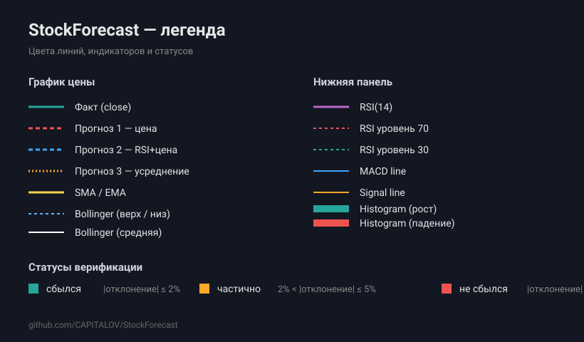

# StockForecast (by KAPITALOV)

–ü—Ä–æ–µ–∫—Ç —Å–∞–π—Ç–∞ –¥–ª—è —Ä–∞–∑–º–µ—â–µ–Ω–∏—è –∏ –ø—É–±–ª–∏–∫–∞—Ü–∏–∏ –ø—Ä–æ–≥–Ω–æ–∑–æ–≤, —Å–æ–∑–¥–∞–Ω–Ω—ã—Ö –∫–æ–º–ø–∞–Ω–∏–µ–π **KAPITALOV** –¥–ª—è –ø—Ä–æ–≥–Ω–æ–∑–∏—Ä–æ–≤–∞–Ω–∏—è –¥–≤–∏–∂–µ–Ω–∏—è —Ç—Ä–µ–Ω–¥–æ–≤ –∞–∫—Ü–∏–π, –∏–Ω–¥–µ–∫—Å–æ–≤ –∏ —ç–º–∏—Ç–µ–Ω—Ç–æ–≤ –¥–ª—è –¥–∞–ª—å–Ω–µ–π—à–µ–π —Ç–æ—Ä–≥–æ–≤–æ–π —Å—Ç—Ä–∞—Ç–µ–≥–∏–∏.

Три независимые линии прогноза на каждый тикер. Автоматическая верификация с фактической историей цен (до 20 лет) с бирж MOEX ISS и Yahoo Finance. Прозрачный расчёт точности — без «подгонки» задним числом. Расчёт MAPE и hit-rate, screener, сравнение тикеров, экспорт CSV и PNG, RSI, MACD, Bollinger Bands, японские свечи, скользящие средние (SMA/EMA), фоновые задачи (Cron) и Telegram-уведомления.

---

## ̆ºÌ æ®–õ–µ–≥–µ–Ω–¥–∞



*Зелёная — факт (или свечи). Красная/синяя/оранжевая — три линии прогноза. Жёлтая — SMA/EMA. Голубая — Bollinger Bands. Фиолетовая — RSI. MACD с гистограммой. Статусы: сбылся (≤ 2%), частично (2–5%), не сбылся (> 5%).*

---

## ̆ΩÌ ≥ã–¢—Ä–µ–±–æ–≤–∞–Ω–∏—è

- PHP 7.4+ —Å —Ä–∞—Å—à–∏—Ä–µ–Ω–∏—è–º–∏ `pdo_mysql`, `mbstring`, `curl`, `fileinfo`
- MySQL 5.7+ / MariaDB 10.3+
- –ò—Å—Ö–æ–¥—è—â–∏–µ HTTP-–∑–∞–ø—Ä–æ—Å—ã –∫ `iss.moex.com`, `query1.finance.yahoo.com`, `stooq.com`
- –î–ª—è Cron: –¥–æ—Å—Ç—É–ø –∫ CLI

## ̆ΩÌ ∫Ä–ë—ã—Å—Ç—Ä—ã–π —Å—Ç–∞—Ä—Ç

```bash
git clone git@github.com:CAPITALOV/StockForecast-by-KAPITALOV.git
cd StockForecast
cp config.example.php config.php
# –æ—Ç—Ä–µ–¥–∞–∫—Ç–∏—Ä–æ–≤–∞—Ç—å config.php (DB_HOST, DB_NAME, DB_USER, DB_PASS)
mkdir -p data static/uploads
chmod 775 data static/uploads
# –û—Ç–∫—Ä—ã—Ç—å –≤ –±—Ä–∞—É–∑–µ—Ä–µ: http://forecast.sotis.org/index.php
